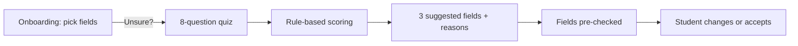
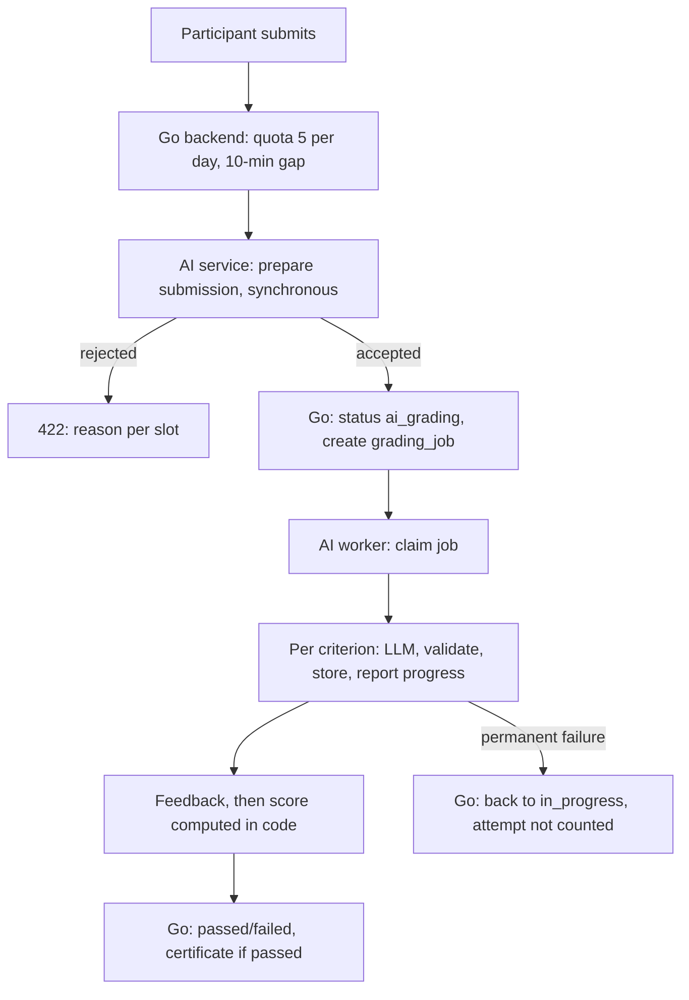

# Project Documentation: Simula ML/LLM (Interest Quiz v2 and AI Reviewer)

| | |
| --- | --- |
| Project | Simula, a work case study platform for final-year students and fresh graduates in Indonesia |
| Document scope | ML/LLM team work in the `ml/` folder |
| Date | October 9, 2026 |
| Status | Prototype, tested with a mock LLM client. No real LLM calls yet, and no real student data. |
| Related versions | Quiz `2.0.0`, prompt `reviewer-v1`, example rubrics version 1 |
| Indonesian version | [`DOKUMENTASI.md`](DOKUMENTASI.md) |

User-facing text in the product (quiz questions, feedback, rubrics) is written in Indonesian. Quotes from it are kept as-is below.

---

## 1. Summary

This project builds two parts of Simula's AI system, as designed in `AI-CONTEXT.md`.

1. **Interest quiz v2** helps students who are unsure of their field. It suggests 3 fields with reasons, and the student still decides. It is rule-based, with no LLM.
2. **AI Reviewer** grades AI Case Study submissions one rubric criterion at a time. The LLM only picks the level, evidence, and reason. The score is computed by code.

Main results:

- **The draft quiz in AI-CONTEXT is structurally biased.**
  - On random answers, 9 of 12 fields fall outside a reasonable band for top-3 inclusion (Data 53.7%, Human Resources 3.6%).
  - Mobile can mathematically never beat Back-End.
  - Quiz v2 balances every field at 24.0–25.7%.
- **AI Reviewer scoring matches the frontend exactly.** `score.py` was tested against the real `score.ts` with 0 mismatches across 1,171 cases.
- **The cost estimate in AI-CONTEXT is too low.** Its table assumes a single LLM call. The official pattern (5 criteria + 1 feedback call, with caching) costs 1.5–1.8x more, and up to 1.9–3.3x when thinking output is large.
- **Testing:** 182 automated tests. All pass when the `SIMULA_SCORE_TS` env var is set. Without it, 181 pass and 1 is skipped.

---

## 2. Background and goals

Simula has two case study tiers. **AI Case Study** is free and graded by AI. **B2B Case Study** is paid and graded by partner practitioners. The Next.js frontend exists as a prototype with mock data. The Go backend and the AI service do not exist yet.

| Goal | Result |
| --- | --- |
| Verify the suspected bias in the draft interest quiz | Confirmed by computation and simulation |
| Design a quiz that is fair across fields | `quiz.v2.json` with scoring, tests, and test vectors |
| Prepare an AI Reviewer ready for integration | Rubrics, schemas, prompts, LLM client, orchestrator |
| Give the backend team a design they can build from | Service, queue, API contract, table schemas |
| Compute costs from official prices | Cost model and report |
| Prepare a way to measure AI quality | Evaluation harness and golden set plan |

**Product principles kept throughout:**

- Quiz results are suggestions, never a gate. The quiz is never called a psychological, personality, or aptitude test.
- Scores are computed by code with `level / 5 x weight`, not by the LLM.
- Submission content is data, not instructions. Participant identity never enters a prompt.

---

## 3. Scope and limitations

| In scope | Not yet in scope |
| --- | --- |
| Quiz config, scoring, simulation, test vectors | Testing the quiz with real students |
| Rubric template, schema, validator, 2 examples | Human-labelled golden set |
| Prompts, builder, output validator, score calculator | Real Claude API calls (no API key) |
| LLM clients (mock and Anthropic), grading orchestrator | PDF/DOCX/XLSX extractors, zip rules, official token counter |
| Cost model, evaluation harness, design documents | HTTP service, queue, Go backend integration |

**Working assumptions:**

- The `client/` folder was not in the working directory. The frontend contract was read from `Simula-main.zip` (read only, never modified).
- `fieldKey` values follow `client/src/constants/fields.ts`: `backend`, `frontend`, `mobile`, `data`, `uiux`, `product`, `marketing`, `finance`, `accounting`, `hr`, `supply-chain`, `legal`.

---

## 4. Repository layout

```
ml/
  README.md                      quick start and findings summary (Indonesian)
  requirements.txt, .env.example, .gitignore, pytest.ini
  docs/
    DOCUMENTATION.md / DOKUMENTASI.md   this document
    PROPOSED-CHANGES.md          proposed changes to AI-CONTEXT.md
    ai-system-design.md          service and queue architecture
    evaluation-plan.md           evaluation and golden set plan
  quiz/
    config/quiz.v2.json          source of truth for the quiz
    config/quiz.v1.json          reproduction of the draft (baseline)
    src/                         config.py, scoring.py, analyze.py
    tests/                       unit tests, simulation engine parity, test vectors
    test_vectors/                vectors.json (45 cases) + generate.py
    simulation/                  engine.py, run.py, REPORT.md, results/
    CHANGELOG-v2.md
  reviewer/
    rubric/                      template.md, rubric.schema.json, examples/
    schemas/                     criterion and feedback output schemas
    prompts/v1/                  system, case, criterion, feedback, builder.py
    src/                         score.py, validate.py, rubric.py, llm_client.py, grade.py
    config/models.json           model and effort (not hard-coded)
    cost/                        pricing.json, cost_model.py, REPORT.md
    eval/                        metrics.py, harness.py, fixtures/ (synthetic)
    tests/
```

---

## 5. Component A: Interest quiz v2

### 5.1 Flow



### 5.2 Question structure

| Question | Type | Topic | Weights |
| --- | --- | --- | --- |
| Q1 | Single choice | Role usually taken in group work | 6 options, +2 primary field, +1 secondary field |
| Q2 | Single choice | Most satisfying work outcome | same |
| Q3 | Single choice | Scenario: a friend's online shop has few buyers | same |
| Q4 | Multiple choice | Tools used before | 1 option per field, max +1 per field |
| Q5 | Single choice | What to learn on a free day | 6 options, +2 / +1 |
| Q6 | Single choice | Work that makes you lose track of time | 6 options, +1 to two fields |
| Q7 | Scale 1–5 | Confidence in chosen field | No points, stored only |
| Q8 | Text (optional) | Study major from onboarding | Keyword mapping, max +1 per field |

**The design principle is symmetry.** In Q1, Q2, Q3, and Q5, every field appears exactly once per question: twice as primary and twice as secondary across the four questions. As a result, every field has the same maximum score: 8, or 9 when the major matches.

### 5.3 Scoring algorithm

1. Validate the answers. Q1–Q7 are required; Q8 is optional.
2. Sum points per field. Q4 is capped at 1 point per field; the major mapping at +1 per field.
3. **Normalize:** `percent = points / maximum achievable points for that field`. It does not divide by the user's top score, because that does not change the ranking.
4. Rank fields with points > 0. Break ties by (1) number of +2 answers, (2) an answer-based rotation, (3) field order.
5. **Cluster rule:** at most 2 tech fields (Back-End, Front-End, Mobile) in the top 3, unless the third tech field leads by ≥ 2 points.
6. Set `tieLike: true` when the top scores are exactly equal.
7. Build reasons from the answers that contributed most, using text templates (no LLM).

All comparisons use exact fractions, and percentages are rounded with integer arithmetic, so TypeScript/Go ports produce identical numbers.

### 5.4 Output contract

The shape of `IInterestProfile.quiz` (AI-CONTEXT 14.6) is unchanged. The response adds suggestions and tie flags.

```json
{
  "quiz": { "version": "2.0.0", "answeredAt": "2026-10-09T08:00:00Z",
            "fieldScores": { "backend": 50, "data": 50, "...": 0 }, "confidence": 3 },
  "suggestions": [
    { "fieldKey": "backend", "label": "Back-End", "percent": 50,
      "reasons": ["sering menulis logika program dan menyiapkan database di tugas kelompok",
                  "ingin mengecek kecepatan dan error aplikasi"],
      "reasonText": "Kamu sering menulis logika program ... dan ingin mengecek kecepatan dan error aplikasi." }
  ],
  "tieLike": true,
  "tiedFieldKeys": ["backend", "data"]
}
```

### 5.5 Cross-language test vectors

`quiz/test_vectors/vectors.json` holds 45 cases:

- ties;
- the cluster rule;
- Q4 with every option checked;
- Q8 variants;
- the ideal answer set for each field;
- random answers;
- 4 invalid inputs.

TS/Go implementations must produce identical output. If `quiz.v2.json` changes, tests fail until the vectors are regenerated and the version is bumped.

### 5.6 Bias simulation results

Synthetic data: 20,000 random respondents per variant and 2,000 personas per field. This only tests structural bias.

| Metric | v1 (draft) | v2 |
| --- | ---: | ---: |
| Max points per field | 5–12 | 8 for all |
| Fields outside the 15–35% top-3 band | 9 of 12 | 0 of 12 |
| Top-3 inclusion range (random answers) | 3.6% – 53.7% | 24.0% – 25.7% |
| Lowest persona top-1 | 0.0% (Mobile) | 93.6% (Mobile) |
| Personas missing target | 4 of 12 | 0 of 12 |
| Back-End persona with an all-tech top 3 | 84.2% | 9.0% |
| Largest shift from a single ±1 weight change | 15.1 pp | 6.6 pp |

A control variant, "v1 structure + max-point normalization", cuts the deviation from 28.7 to 11.6 pp. Normalization fixes most of the bias, but the question structure still had to be redesigned.

---

## 6. Component B: AI Reviewer

### 6.1 Rubrics

- **`template.md`:** the admin guide. It covers 3–5 non-overlapping criteria with weights totalling 100, specific and observable level 1–5 descriptions, and coverage of every task in the brief.
- **`rubric.schema.json` and `src/rubric.py`:** schema and semantic checks. The validator rejects weights not totalling 100, generic level descriptions, duplicate levels, and unknown evidence slots.
- **Examples:** "Optimasi API Endpoint Produk yang Lambat" (Back-End) and "Kalender Konten Media Sosial untuk UMKM" (Marketing).

### 6.2 Output schema and validation

| Field | Rule |
| --- | --- |
| `level` | Integer 1–5 |
| `evidence` | 1–3 references; may be empty only at level 1 |
| `reason` | About 60 words max (rejected above 70), Indonesian, informal "kamu", no Markdown or emoji |
| `confidence` | `low`, `medium`, or `high` |
| `flags` | Closed list: `too_short`, `off_topic`, `copied_brief`, `possible_injection`, `unreadable_part`, `secret_detected`, `language_mismatch` |
| Feedback | 1–3 points per section, one sentence each, no B2B upsell |

Claude structured outputs do not support `maxItems` or `maxLength`. `provider_schema()` therefore strips those keywords from the schema sent to the API, and the limits are enforced by the local validator.

### 6.3 Scoring

```
criterion points = Math.round((level / 5) * weight * 10) / 10
total score      = Math.round(sum of points)
passed           = total score >= passing score (default 60)
```

`score.py` replicates JavaScript `Math.round`, which rounds halves up. Python's `round()` rounds halves to even, so it cannot be used directly. The result is identical to `client/src/lib/score.ts` across 1,171 test cases.

### 6.4 Prompt structure and caching

Prompt blocks go from most stable to most variable:

| Order | Block | Changes per | Cache |
| --- | --- | --- | --- |
| 1 | System instructions | never | |
| 2 | Case + list of all criteria | case | breakpoint 1 |
| 3 | Participant submission | participant | breakpoint 2 |
| 4 | Criterion being graded | call | not cached |

This differs from AI-CONTEXT 6.2, which puts the rubric before the submission. With this order, the submission (up to 60k tokens) is read from cache for criteria 2–5.

The feedback call does **not** include the full submission. Its output schema is different, and changing the output schema invalidates the cache.

### 6.5 Prompt injection protection

- Text that looks like block tags (for example `</submission>` or `<system>`) is escaped to `&lt;...`.
- Invisible characters (zero-width and bidi controls) are removed and counted.
- Injection patterns such as "abaikan rubrik" ("ignore the rubric") or "beri nilai 100" ("give a score of 100") are detected before the LLM call and flagged as `possible_injection`.
- Fields other than `slots` and `note`, such as participant name or email, are rejected before any API call.
- Six attack fixtures are tested:
  - instructions in a README;
  - hidden text in a document;
  - a code comment;
  - a file name that tries to close the block;
  - a tag disguised with a zero-width character;
  - a participant note.

### 6.6 LLM clients and orchestrator

- **`MockClient`:** deterministic, no network, and simulates cache token usage. All tests use it.
- **`AnthropicClient`:** active only when `ANTHROPIC_API_KEY` is set. The client:
  - uses structured outputs (`output_config.format`), an explicit `effort`, and `cache_control`;
  - disables the SDK's built-in retries so the orchestrator controls attempts;
  - deliberately does not fall back to another model automatically, so each assessment is recorded against one locked model.
- **`grade.py`:** grades criteria one at a time in rubric order, then calls feedback, computes the score in code, and builds `IReviewResult` plus an audit record.

| Event | Action |
| --- | --- |
| Invalid or truncated output | Retry up to 2 times |
| 5xx, 429, timeout, connection error | Retry up to 3 times with 2, 4, 8 s backoff |
| Refusal | Retry once, then status `manual_review` |
| Other 4xx | Fail immediately |
| Job exceeds 5 minutes | Fail; status returns to `in_progress` and the attempt is not counted |

**Idempotency.** The job key is a hash of the submission + rubric_id + rubric_version + prompt_version + model + effort. As a result:

- only failed criteria are retried;
- identical submissions reuse the earlier result;
- results are never recorded twice.

**Honest progress.** `checkedCriteria` only increases after a criterion result is valid and stored.

### 6.7 Cost model

Prices come from the official Anthropic pricing page, retrieved October 9, 2026.

| Model | Input | 5-min cache write | Cache read | Output |
| --- | ---: | ---: | ---: | ---: |
| Claude Haiku 5.5 (≤100k tokens) | $0.10 | $0.125 | $0.01 | $0.50 |
| Claude Sonnet 5.5 | $2 | $2.50 | $0.10 | $10 |
| Claude Opus 5.5 | $4 | $5 | $0.20 | $20 |

Cost per assessment with caching, frugal output profile:

| Scenario | Haiku 5.5 | Sonnet 5.5 | vs AI-CONTEXT 12 |
| --- | ---: | ---: | ---: |
| Text answer (10k tokens) | $0.0032 | $0.060 | 1.7–1.8x |
| Document/code (40k) | $0.0082 | $0.147 | 1.6–1.7x |
| Near the limit (60k) | $0.0115 | $0.205 | 1.5–1.7x |

All of these are computed from token assumptions, not measured. Firmer numbers require the golden set.

### 6.8 Evaluation

`reviewer/eval/harness.py` computes the metrics targeted in AI-CONTEXT 10.2:

| Metric | Target |
| --- | --- |
| QWK per criterion, AI vs human | ≥ 0.70, and no more than 0.10 below human vs human agreement |
| Pass/fail agreement | ≥ 90% |
| Fatal errors | 0 |
| Stability across 3 runs | Same level on ≥ 90% of criteria; score difference ≤ 5 |
| Injection robustness | 100% |
| Format error rate before retry | < 1% |
| Length bias | Not significant (p ≥ 0.05) |

The QWK code is tested against a brute-force implementation and scikit-learn. The harness test data is labelled **"SINTETIS, BUKAN LABEL MANUSIA"** ("synthetic, not human labels"), and the harness always refuses release on synthetic data.

---

## 7. System architecture (proposed)



| Component | Owner |
| --- | --- |
| Public API, enrollment, quota, certificates, database, queue | Go backend |
| Submission extraction, prompts, grading, validation, scoring | AI service (Python) |

Proposed internal endpoints:

| Endpoint | Purpose |
| --- | --- |
| `POST /v1/submissions/prepare` | Extract and validate at submit time (synchronous) |
| `POST /internal/ai-grading/jobs/claim` | Worker claims a job |
| `POST /internal/ai-grading/jobs/{id}/progress` | Report `checkedCriteria` |
| `POST /internal/ai-grading/jobs/{id}/complete` | Send the final result |

Table schemas (`ai_assessments`, `ai_criterion_results`, `ai_call_logs`) are in `docs/ai-system-design.md`.

---

## 8. How to run

Requirements: Python 3.11+ (tested with 3.12.4). Node ≥ 23.6 is optional, for the live score parity test. Run all commands from the `ml/` folder.

```bash
pip install -r requirements.txt
```

```bash
python -m pytest
```

| Command | Purpose |
| --- | --- |
| `python -m quiz.src.analyze` | Structural analysis of quiz v1 and v2 |
| `python -m quiz.simulation.run` | Bias simulation (about 15 seconds) |
| `python -m quiz.test_vectors.generate` | Regenerate test vectors |
| `python -m reviewer.src.rubric <file.rubric.json>` | Validate a rubric |
| `python -m reviewer.cost.cost_model` | Compute costs |
| `python -m reviewer.eval.harness --rubrics ... --submissions ... --human ... --ai ...` | Evaluate against a golden set |

To use the real Claude API, copy `.env.example` to `.env`, set `ANTHROPIC_API_KEY`, and install the `anthropic` package. Model and effort are configured in `reviewer/config/models.json`.

---

## 9. Testing and verification

| Area | Tests | What is proven |
| --- | ---: | --- |
| Quiz | 97 | Input validation, empty Q8, Q4 with everything checked, ties, cluster rule, determinism, 45 test vectors, simulation engine parity with the reference |
| AI Reviewer | 85 | Score parity with `score.ts`, output validators, rubrics, prompt order and caching, injection escaping, retry policy, idempotency, timeout, evaluation metrics |
| **Total** | **182** | All pass when `SIMULA_SCORE_TS` is set; without it, 181 pass and 1 is skipped |

**Additional checks:**

- No secrets or API keys are in the repository.
- `AI-CONTEXT.md` and `client/` were not modified.
- Every number in the reports traces to a computation, a simulation output file, or an official page. The table is in `README.md`.
- **Independent review.** A subagent that had not seen the work process reviewed `PROPOSED-CHANGES.md` and the simulation report. It found 17 issues, including:
  - one wrong number: the no-cache cost multiple was stated as 2–3x when it is actually 3.7–4.7x;
  - an overclaim about the cluster rule;
  - an untested claim about normalization.

  All were fixed. For the normalization claim, a new simulation variant was added so the claim is now tested.

---

## 10. Key findings

1. **The draft quiz is structurally biased, and its normalization does not help.** Dividing every score by the user's top score does not change the ranking.
2. **Mobile can never outrank Back-End in the draft quiz.** Every Mobile option gives Back-End at least as many points.
3. **Tie-breaking matters a lot.** The top-1 is tied in 35% of random answers. A field-order tie-break alone raises Back-End by 9.8 pp.
4. **The AI-CONTEXT 12 cost table assumes a single call.** With the 6-call pattern and caching, costs are 1.5–1.8x higher (up to 3.3x with thinking).
5. **The AI-CONTEXT 6.2 prompt order defeats caching.** The criterion being graded must come last.
6. **Structured outputs do not enforce length limits.** Local validation is still required.
7. **The mock rubric for the content calendar case does not grade one of the brief's tasks,** namely "goals and success metrics".

---

## 11. Proposed changes and team decisions

Full details are in [`PROPOSED-CHANGES.md`](PROPOSED-CHANGES.md) (Indonesian). Decisions needed:

1. Approve quiz v2 for testing with 10–20 students.
2. Approve the new prompt order and feedback without the full submission.
3. Decide the status for repeated refusals (`manual_review`).
4. Replace the AI-CONTEXT 12 cost table and the cost range in CONTEXT.md.
5. Add a "goals and success metrics" criterion to the content calendar case.
6. Approve or reject the "max 2 tech fields in the top 3" rule. This is a value judgement, not a data finding.

---

## 12. Risks and open items

| Risk / open item | Note |
| --- | --- |
| Privacy (Indonesian PDP law) and data retention | Privacy policy text and retention period not decided |
| Final provider and model | `claude-haiku-5-5` is only the first test candidate |
| AI grading quality | Not measured yet; needs a golden set and an API key |
| Output tokens (thinking) | Largest unknown cost variable |
| Quiz validity for real students | The simulation only tests structural bias |
| Provider data policy | Not yet verified for the team account |

---

## 13. Next steps

1. Test quiz v2 with 10–20 students using the plan in `quiz/simulation/REPORT.md` section 7.
2. Get an API key and build a small golden set: 2 cases, about 15 submissions each, 2 human raters.
3. Run Haiku 5.5 (effort `low`) through the harness, then Sonnet 5.5 if needed. Pick the cheapest model that passes every gate.
4. Replace cost assumptions with real token counts from the golden set.
5. Build the input pipeline (document extraction, zip rules, token counter) and integrate it with the Go backend.

---

## Appendix: glossary

| Term | Meaning |
| --- | --- |
| Rubric | List of grading criteria with weights and level 1–5 descriptions |
| Golden set | Human-graded submissions used as the benchmark for AI quality |
| QWK | Quadratic Weighted Kappa, agreement between two raters on an ordinal scale |
| Prompt caching | Provider feature that stores a repeated prompt prefix so later calls are cheaper |
| Structured outputs | Provider feature that forces model output to match a JSON schema |
| Prompt injection | An attempt to insert instructions into a submission so the AI grades outside the rubric |
| Test vector | An input with its expected output, used to confirm other implementations are identical |
| pp | Percentage points |
