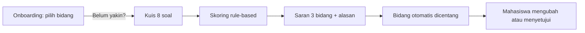
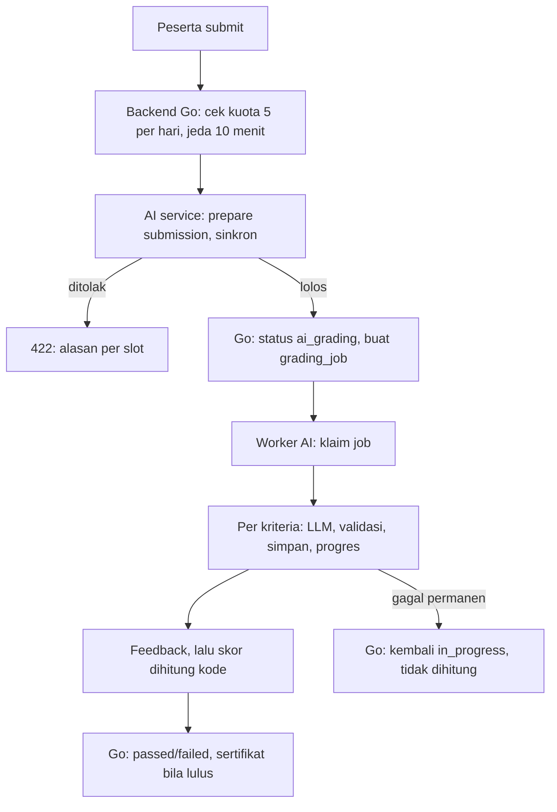

# Dokumentasi Proyek: Simula ML/LLM (Kuis Minat v2 dan AI Reviewer)

| | |
| --- | --- |
| Proyek | Simula, platform case study kerja untuk mahasiswa tingkat akhir dan fresh graduate di Indonesia |
| Lingkup dokumen | Pekerjaan tim ML/LLM di folder `ml/` |
| Tanggal | 9 Oktober 2026 |
| Status | Prototipe teruji dengan klien LLM palsu (mock). Belum ada panggilan LLM sungguhan dan belum ada data mahasiswa nyata. |
| Versi terkait | Kuis `2.0.0`, prompt `reviewer-v1`, rubrik contoh versi 1 |
| Versi Bahasa Inggris | [`DOCUMENTATION.md`](DOCUMENTATION.md) |

---

## 1. Ringkasan

Proyek ini membangun dua bagian sistem AI Simula yang dirancang di `AI-CONTEXT.md`.

1. **Kuis minat v2** membantu mahasiswa yang belum yakin bidangnya. Hasilnya berupa saran 3 bidang beserta alasan, dan mahasiswa tetap yang memutuskan. Skornya dihitung dengan aturan (rule-based), tanpa LLM.
2. **AI Reviewer** menilai submission AI Case Study per kriteria rubrik. LLM hanya memilih level, bukti, dan alasan; skor dihitung oleh kode.

Hasil utama:

- **Draf kuis di AI-CONTEXT bias secara struktural.**
  - Pada jawaban acak, 9 dari 12 bidang berada di luar pita wajar masuk top-3 (Data 53,7%, Human Resources 3,6%).
  - Mobile secara matematis tidak pernah bisa mengalahkan Back-End.
  - Kuis v2 menyeimbangkan semua bidang ke 24,0-25,7%.
- **Skor AI Reviewer identik dengan frontend.** `score.py` diuji terhadap `score.ts` asli: 0 selisih dari 1.171 kasus.
- **Estimasi biaya di AI-CONTEXT terlalu rendah.** Tabelnya dihitung sebagai satu panggilan LLM. Dengan pola resmi (5 kriteria + 1 feedback, memakai cache), biayanya 1,5-1,8x lebih tinggi, dan bisa 1,9-3,3x bila output thinking besar.
- **Pengujian:** 182 tes otomatis. Saat env var `SIMULA_SCORE_TS` diset, semuanya lolos. Tanpa env var itu, 181 lolos dan 1 dilewati.

---

## 2. Latar belakang dan tujuan

Simula punya dua tier case study: **AI Case Study** (gratis, dinilai AI) dan **B2B Case Study** (berbayar, dinilai praktisi mitra). Frontend Next.js sudah berupa prototipe dengan data tiruan. Backend Go dan layanan AI belum ada.

Tujuan pekerjaan ini:

| Tujuan | Hasil |
| --- | --- |
| Memverifikasi dugaan bias pada draf kuis minat | Terbukti lewat perhitungan dan simulasi |
| Merancang kuis yang adil antarbidang | `quiz.v2.json` beserta skoring, tes, dan test vector |
| Menyiapkan AI Reviewer yang siap diintegrasikan | Rubrik, skema, prompt, klien LLM, orkestrator |
| Memberi tim backend desain yang bisa langsung dipakai | Desain service, antrean, kontrak API, skema tabel |
| Menghitung biaya dengan harga resmi | Model biaya dan laporan |
| Menyiapkan cara mengukur kualitas AI | Harness evaluasi dan rencana golden set |

**Prinsip produk yang dijaga:**

- Hasil kuis hanya saran, bukan gerbang. Kuis tidak disebut tes psikologi, kepribadian, atau bakat.
- Skor penilaian dihitung kode dengan rumus `level / 5 x bobot`, bukan oleh LLM.
- Isi submission diperlakukan sebagai data, bukan instruksi. Identitas peserta tidak pernah masuk ke prompt.

---

## 3. Ruang lingkup dan batasan

| Termasuk | Belum termasuk |
| --- | --- |
| Config, skoring, simulasi, dan test vector kuis | Uji kuis ke mahasiswa sungguhan |
| Template, skema, dan validator rubrik, dengan 2 contoh | Golden set berlabel manusia |
| Prompt, builder, validator output, penghitung skor | Panggilan Claude API sungguhan (tidak ada API key) |
| Klien LLM: mock dan Anthropic, orkestrator penilaian | Ekstraktor PDF/DOCX/XLSX, aturan zip, penghitung token resmi |
| Model biaya, harness evaluasi, dokumen desain | Service HTTP, antrean, integrasi dengan backend Go |

**Asumsi kerja:**

- Folder `client/` tidak ada di folder kerja. Kontrak frontend dibaca dari `Simula-main.zip`, hanya dibaca dan tidak diubah.
- `fieldKey` mengikuti `client/src/constants/fields.ts`: `backend`, `frontend`, `mobile`, `data`, `uiux`, `product`, `marketing`, `finance`, `accounting`, `hr`, `supply-chain`, `legal`.

---

## 4. Struktur repositori

```
ml/
  README.md                      panduan cepat dan ringkasan temuan
  requirements.txt, .env.example, .gitignore, pytest.ini
  docs/
    DOKUMENTASI.md / DOCUMENTATION.md   dokumen ini
    PROPOSED-CHANGES.md          usulan perubahan ke AI-CONTEXT.md
    ai-system-design.md          arsitektur service dan antrean
    evaluation-plan.md           rencana evaluasi dan golden set
  quiz/
    config/quiz.v2.json          sumber kebenaran kuis
    config/quiz.v1.json          reproduksi draf (pembanding)
    src/                         config.py, scoring.py, analyze.py
    tests/                       unit test, kecocokan mesin simulasi, test vector
    test_vectors/                vectors.json (45 kasus) + generate.py
    simulation/                  engine.py, run.py, REPORT.md, results/
    CHANGELOG-v2.md
  reviewer/
    rubric/                      template.md, rubric.schema.json, examples/
    schemas/                     skema output kriteria dan feedback
    prompts/v1/                  system, case, criterion, feedback, builder.py
    src/                         score.py, validate.py, rubric.py, llm_client.py, grade.py
    config/models.json           model dan effort (tidak di-hardcode)
    cost/                        pricing.json, cost_model.py, REPORT.md
    eval/                        metrics.py, harness.py, fixtures/ (sintetis)
    tests/
```

---

## 5. Komponen A: Kuis minat v2

### 5.1 Alur



### 5.2 Struktur soal

| Soal | Tipe | Isi | Bobot |
| --- | --- | --- | --- |
| Q1 | Pilihan tunggal | Bagian yang sering diambil di tugas kelompok | 6 opsi, +2 bidang utama, +1 bidang pendamping |
| Q2 | Pilihan tunggal | Hasil kerja yang paling memuaskan | idem |
| Q3 | Pilihan tunggal | Skenario toko online yang sepi pembeli | idem |
| Q4 | Pilihan ganda | Tools yang pernah dipakai | 1 opsi per bidang, maks. +1 per bidang |
| Q5 | Pilihan tunggal | Pilihan belajar di hari kosong | 6 opsi, +2 / +1 |
| Q6 | Pilihan tunggal | Pekerjaan yang membuat lupa waktu | 6 opsi, +1 ke dua bidang |
| Q7 | Skala 1-5 | Keyakinan terhadap bidang | Tidak menambah poin, hanya disimpan |
| Q8 | Teks (opsional) | Jurusan dari onboarding | Pemetaan kata kunci, maks. +1 per bidang |

**Prinsip desainnya simetri.** Di Q1, Q2, Q3, dan Q5, setiap bidang muncul tepat sekali per soal: 2 kali sebagai bidang utama dan 2 kali sebagai pendamping. Hasilnya, poin maksimum semua bidang sama: 8, atau 9 bila jurusan cocok.

### 5.3 Algoritma skoring

1. Validasi jawaban. Q1-Q7 wajib; Q8 opsional.
2. Jumlahkan poin per bidang. Q4 dibatasi maks. 1 poin per bidang; jurusan maks. +1 per bidang.
3. **Normalisasi:** `persen = poin / poin maksimum yang dapat dicapai bidang itu`. Tidak memakai skor tertinggi pengguna, karena cara itu tidak mengubah urutan.
4. Urutkan bidang yang punya poin > 0. Bila seri, pecah berjenjang: (1) jumlah jawaban +2, (2) rotasi berbasis jawaban, (3) urutan bidang.
5. **Aturan klaster:** maksimal 2 bidang tech (Back-End, Front-End, Mobile) di top-3, kecuali bidang tech ketiga unggul ≥ 2 poin.
6. Tandai `tieLike: true` bila skor bidang teratas sama persis.
7. Susun alasan dari jawaban yang paling menyumbang poin, dengan template teks tanpa LLM.

Semua perbandingan memakai pecahan eksak, dan persen dibulatkan dengan aritmetika bilangan bulat, supaya implementasi TypeScript/Go menghasilkan angka identik.

### 5.4 Kontrak keluaran

Bentuk `IInterestProfile.quiz` (AI-CONTEXT 14.6) tidak berubah. Respons ditambah saran dan penanda seri.

```json
{
  "quiz": { "version": "2.0.0", "answeredAt": "2026-10-09T08:00:00Z",
            "fieldScores": { "backend": 50, "data": 50, "...": 0 }, "confidence": 3 },
  "suggestions": [
    { "fieldKey": "backend", "label": "Back-End", "percent": 50,
      "reasons": ["sering menulis logika program dan menyiapkan database di tugas kelompok",
                  "ingin mengecek kecepatan dan error aplikasi"],
      "reasonText": "Kamu sering menulis logika program ... dan ingin mengecek kecepatan dan error aplikasi." }
  ],
  "tieLike": true,
  "tiedFieldKeys": ["backend", "data"]
}
```

### 5.5 Test vector lintas bahasa

`quiz/test_vectors/vectors.json` berisi 45 kasus:

- seri;
- aturan klaster;
- Q4 dicentang semua;
- variasi Q8;
- jawaban ideal tiap bidang;
- jawaban acak;
- 4 input tidak valid.

Implementasi TS/Go wajib menghasilkan keluaran yang identik. Bila `quiz.v2.json` berubah, tes akan gagal sampai vector dibuat ulang dan versi dinaikkan.

### 5.6 Hasil simulasi bias

Data sintetis: 20.000 jawaban acak per varian dan 2.000 persona per bidang. Simulasi ini hanya menguji bias struktural.

| Metrik | v1 (draf) | v2 |
| --- | ---: | ---: |
| Poin maks. per bidang | 5-12 | 8 untuk semua |
| Bidang di luar pita 15-35% masuk top-3 | 9 dari 12 | 0 dari 12 |
| Rentang masuk top-3 (jawaban acak) | 3,6% - 53,7% | 24,0% - 25,7% |
| Top-1 persona terendah | 0,0% (Mobile) | 93,6% (Mobile) |
| Persona yang gagal target | 4 dari 12 | 0 dari 12 |
| Persona Back-End dengan top-3 semuanya tech | 84,2% | 9,0% |
| Pergeseran terbesar akibat satu bobot ±1 | 15,1 pp | 6,6 pp |

Varian pembanding "struktur v1 + normalisasi poin maks." menurunkan deviasi dari 28,7 ke 11,6 pp. Normalisasi menyelesaikan sebagian besar bias, tetapi struktur soal tetap perlu dirombak.

---

## 6. Komponen B: AI Reviewer

### 6.1 Rubrik

- **`template.md`:** panduan admin. Isinya 3-5 kriteria dengan total bobot 100, tanpa tumpang tindih, deskripsi level 1-5 yang spesifik dan bisa diamati, dan setiap tugas di brief tercakup kriteria.
- **`rubric.schema.json` dan `src/rubric.py`:** validasi skema dan aturan semantik. Validator menolak total bobot ≠ 100, deskripsi level generik, level kembar, dan slot bukti yang tidak ada.
- **Contoh:** "Optimasi API Endpoint Produk yang Lambat" (Back-End) dan "Kalender Konten Media Sosial untuk UMKM" (Marketing).

### 6.2 Skema output dan validasi

| Field | Aturan |
| --- | --- |
| `level` | Bilangan bulat 1-5 |
| `evidence` | 1-3 rujukan; boleh kosong hanya pada level 1 |
| `reason` | Maks. sekitar 60 kata (ditolak di atas 70), Bahasa Indonesia, "kamu", tanpa Markdown dan emoji |
| `confidence` | `low`, `medium`, atau `high` |
| `flags` | Daftar tertutup: `too_short`, `off_topic`, `copied_brief`, `possible_injection`, `unreadable_part`, `secret_detected`, `language_mismatch` |
| Feedback | 1-3 poin per bagian, satu kalimat per poin, tanpa ajakan B2B |

Structured output Claude tidak mendukung `maxItems` dan `maxLength`. Karena itu `provider_schema()` membuang kata kunci tersebut dari skema yang dikirim ke API, dan batasnya ditegakkan oleh validator lokal.

### 6.3 Skor

```
poin kriteria = Math.round((level / 5) * bobot * 10) / 10
skor total    = Math.round(jumlah poin)
lulus         = skor total >= ambang lulus (default 60)
```

`score.py` meniru `Math.round` JavaScript, yang membulatkan setengah ke atas, karena `round()` Python membulatkan ke bilangan genap. Hasilnya identik dengan `client/src/lib/score.ts` di 1.171 kasus uji.

### 6.4 Struktur prompt dan cache

Bagian prompt diurutkan dari yang paling stabil ke yang paling sering berubah:

| Urutan | Blok | Berubah per | Cache |
| --- | --- | --- | --- |
| 1 | Instruksi sistem | tidak pernah | |
| 2 | Case + daftar semua kriteria | case | breakpoint 1 |
| 3 | Submission peserta | peserta | breakpoint 2 |
| 4 | Kriteria yang sedang dinilai | panggilan | tidak di-cache |

Urutan ini berbeda dari AI-CONTEXT 6.2, yang menaruh rubrik sebelum submission. Dengan urutan di sini, submission (sampai 60 ribu token) terbaca dari cache untuk kriteria ke-2 sampai ke-5.

Panggilan feedback **tidak** menyertakan submission utuh. Alasannya, skema output feedback berbeda, dan mengganti skema output membatalkan cache.

### 6.5 Proteksi prompt injection

- Teks yang mirip tag blok (misalnya `</submission>` atau `<system>`) di-escape menjadi `&lt;...`.
- Karakter tak terlihat (zero-width dan kontrol bidi) dibuang dan jumlahnya dihitung.
- Pola injection seperti "abaikan rubrik" atau "beri nilai 100" dideteksi sebelum panggilan LLM dan diberi flag `possible_injection`.
- Field selain `slots` dan `note`, misalnya nama atau email peserta, ditolak sebelum ada panggilan API.
- Enam fixture serangan dites:
  - instruksi di README;
  - teks tersembunyi di dokumen;
  - komentar kode;
  - nama berkas yang mencoba menutup blok;
  - tag yang disamarkan dengan karakter zero-width;
  - catatan peserta.

### 6.6 Klien LLM dan orkestrator

- **`MockClient`:** deterministik, tanpa jaringan, dan meniru pemakaian token cache. Dipakai untuk semua tes.
- **`AnthropicClient`:** aktif hanya bila `ANTHROPIC_API_KEY` ada. Klien ini:
  - memakai structured output (`output_config.format`), `effort` eksplisit, dan `cache_control`;
  - mematikan retry bawaan SDK supaya jumlah percobaan dikendalikan orkestrator;
  - sengaja tidak memakai fallback otomatis ke model lain, supaya satu penilaian tercatat memakai satu model.
- **`grade.py`:** menilai kriteria satu per satu sesuai urutan rubrik, lalu memanggil feedback, menghitung skor dengan kode, dan menyusun `IReviewResult` beserta catatan audit.

| Kejadian | Tindakan |
| --- | --- |
| Output tidak valid atau terpotong | Ulangi maks. 2 kali |
| Error 5xx, 429, timeout, koneksi | Ulangi maks. 3 kali, jeda 2, 4, 8 detik |
| Refusal | Ulangi 1 kali, lalu status `manual_review` |
| Error 4xx lain | Langsung gagal |
| Job melewati 5 menit | Gagal; status kembali `in_progress`, percobaan tidak dihitung |

**Idempotensi.** Kunci job dibentuk dari hash submission + rubric_id + rubric_version + prompt_version + model + effort. Akibatnya:

- hanya kriteria yang gagal yang diulang;
- submission identik memakai hasil lama;
- hasil tidak tercatat dua kali.

**Progres jujur.** `checkedCriteria` hanya naik setelah hasil kriteria valid dan tersimpan.

### 6.7 Model biaya

Harga diambil dari halaman pricing resmi Anthropic, dibuka 9 Oktober 2026.

| Model | Input | Cache write 5 menit | Cache read | Output |
| --- | ---: | ---: | ---: | ---: |
| Claude Haiku 5.5 (≤100k token) | $0,10 | $0,125 | $0,01 | $0,50 |
| Claude Sonnet 5.5 | $2 | $2,50 | $0,10 | $10 |
| Claude Opus 5.5 | $4 | $5 | $0,20 | $20 |

Biaya per penilaian dengan cache, profil output hemat:

| Skenario | Haiku 5.5 | Sonnet 5.5 | Dibanding AI-CONTEXT 12 |
| --- | ---: | ---: | ---: |
| Isian teks (10 rb token) | $0,0032 | $0,060 | 1,7-1,8x |
| Dokumen/kode (40 rb) | $0,0082 | $0,147 | 1,6-1,7x |
| Mendekati batas (60 rb) | $0,0115 | $0,205 | 1,5-1,7x |

Semua angka ini dihitung dari asumsi token, bukan diukur. Angka yang lebih pasti baru bisa diperoleh dari golden set.

### 6.8 Evaluasi

`reviewer/eval/harness.py` menghitung metrik sesuai target AI-CONTEXT 10.2:

| Metrik | Target |
| --- | --- |
| QWK per kriteria, AI vs manusia | ≥ 0,70, dan tidak lebih dari 0,10 di bawah kesepakatan manusia vs manusia |
| Kesepakatan lulus/belum lulus | ≥ 90% |
| Kesalahan fatal | 0 |
| Stabilitas 3 run | Level sama di ≥ 90% kriteria; selisih skor ≤ 5 |
| Ketahanan injection | 100% |
| Format error sebelum retry | < 1% |
| Bias panjang tulisan | Tidak signifikan (p ≥ 0,05) |

Kode QWK diuji terhadap implementasi brute force dan scikit-learn. Data uji harness diberi label **"SINTETIS, BUKAN LABEL MANUSIA"**, dan harness selalu menolak rilis untuk data sintetis.

---

## 7. Arsitektur sistem (usulan)



| Komponen | Pemilik |
| --- | --- |
| API publik, enrollment, kuota, sertifikat, database, antrean | Backend Go |
| Ekstraksi submission, prompt, penilaian, validasi, skor | AI service (Python) |

Endpoint internal yang diusulkan:

| Endpoint | Fungsi |
| --- | --- |
| `POST /v1/submissions/prepare` | Ekstraksi dan validasi saat submit (sinkron) |
| `POST /internal/ai-grading/jobs/claim` | Worker mengambil job |
| `POST /internal/ai-grading/jobs/{id}/progress` | Melaporkan `checkedCriteria` |
| `POST /internal/ai-grading/jobs/{id}/complete` | Mengirim hasil akhir |

Skema tabel (`ai_assessments`, `ai_criterion_results`, `ai_call_logs`) ada di `docs/ai-system-design.md`.

---

## 8. Cara menjalankan

Kebutuhan: Python 3.11+ (diuji dengan 3.12.4). Node ≥ 23.6 opsional, untuk tes paritas skor langsung. Semua perintah dijalankan dari folder `ml/`.

```bash
pip install -r requirements.txt
```

```bash
python -m pytest
```

| Perintah | Fungsi |
| --- | --- |
| `python -m quiz.src.analyze` | Analisis struktur kuis v1 dan v2 |
| `python -m quiz.simulation.run` | Simulasi bias (sekitar 15 detik) |
| `python -m quiz.test_vectors.generate` | Membuat ulang test vector |
| `python -m reviewer.src.rubric <berkas.rubric.json>` | Validasi rubrik |
| `python -m reviewer.cost.cost_model` | Menghitung biaya |
| `python -m reviewer.eval.harness --rubrics ... --submissions ... --human ... --ai ...` | Evaluasi terhadap golden set |

Untuk memakai Claude API sungguhan: salin `.env.example` menjadi `.env`, isi `ANTHROPIC_API_KEY`, lalu pasang paket `anthropic`. Model dan effort diatur di `reviewer/config/models.json`.

---

## 9. Pengujian dan verifikasi

| Area | Jumlah tes | Yang dibuktikan |
| --- | ---: | --- |
| Kuis | 97 | Validasi input, Q8 kosong, Q4 dicentang semua, seri, aturan klaster, determinisme, 45 test vector, kecocokan mesin simulasi dengan referensi |
| AI Reviewer | 85 | Paritas skor dengan `score.ts`, validator output, rubrik, urutan prompt dan cache, escaping injection, kebijakan retry, idempotensi, batas waktu, metrik evaluasi |
| **Total** | **182** | Semua lolos saat env `SIMULA_SCORE_TS` diset; tanpa env itu 181 lolos dan 1 dilewati |

**Verifikasi tambahan:**

- Tidak ada rahasia atau API key di repositori.
- `AI-CONTEXT.md` dan `client/` tidak diubah.
- Setiap angka di laporan bisa ditelusuri ke hasil perhitungan, berkas hasil simulasi, atau halaman resmi. Tabelnya ada di `README.md`.
- **Tinjauan independen.** Subagent yang tidak melihat proses kerja meninjau `PROPOSED-CHANGES.md` dan laporan simulasi. Ia menemukan 17 masalah, termasuk:
  - satu angka salah: kelipatan biaya tanpa cache ditulis 2-3x, padahal yang benar 3,7-4,7x;
  - klaim berlebihan tentang aturan klaster;
  - klaim yang belum diuji tentang normalisasi.
  
  Semua sudah diperbaiki. Untuk klaim normalisasi, ditambahkan varian simulasi baru supaya klaim itu teruji.

---

## 10. Temuan utama

1. **Draf kuis bias secara struktural, dan normalisasinya tidak membantu.** Membagi semua skor dengan skor tertinggi pengguna tidak mengubah urutan.
2. **Mobile tidak pernah bisa melampaui Back-End di draf kuis.** Setiap opsi Mobile memberi poin Back-End yang sama atau lebih besar.
3. **Tie-break berpengaruh besar.** Top-1 seri pada 35% jawaban acak. Tie-break "urutan bidang" saja menaikkan Back-End sebesar 9,8 pp.
4. **Tabel biaya AI-CONTEXT 12 dihitung sebagai satu panggilan.** Dengan pola 6 panggilan dan cache, biayanya 1,5-1,8x (sampai 3,3x dengan thinking).
5. **Urutan prompt AI-CONTEXT 6.2 menghalangi cache.** Kriteria yang dinilai harus ditaruh paling akhir.
6. **Structured output tidak menegakkan batas panjang.** Validasi lokal tetap wajib.
7. **Rubrik tiruan untuk case kalender konten tidak menilai salah satu tugas di brief,** yaitu "tujuan dan metrik keberhasilan".

---

## 11. Usulan perubahan dan keputusan tim

Rincian lengkap ada di [`PROPOSED-CHANGES.md`](PROPOSED-CHANGES.md). Keputusan yang dibutuhkan:

1. Setujui kuis v2 untuk diuji ke 10-20 mahasiswa.
2. Setujui urutan prompt baru dan feedback tanpa submission utuh.
3. Tentukan status untuk refusal berulang (`manual_review`).
4. Ganti tabel biaya AI-CONTEXT 12 dan rentang biaya di CONTEXT.md.
5. Tambah kriteria "Tujuan dan metrik keberhasilan" di case kalender konten.
6. Setujui atau tolak aturan maks. 2 bidang tech di top-3. Ini keputusan nilai, bukan temuan data.

---

## 12. Risiko dan hal terbuka

| Risiko / hal terbuka | Catatan |
| --- | --- |
| Privasi (UU PDP) dan retensi data | Teks kebijakan privasi dan lama penyimpanan belum ditentukan |
| Provider dan model final | `claude-haiku-5-5` hanya kandidat uji pertama |
| Kualitas penilaian AI | Belum diukur; butuh golden set dan API key |
| Token output (thinking) | Variabel biaya terbesar yang belum diketahui |
| Validitas kuis untuk mahasiswa nyata | Simulasi hanya menguji bias struktural |
| Kebijakan data provider | Belum diverifikasi untuk akun tim |

---

## 13. Langkah berikutnya

1. Uji kuis v2 ke 10-20 mahasiswa dengan rencana di `quiz/simulation/REPORT.md` bagian 7.
2. Siapkan API key dan susun golden set kecil: 2 case, masing-masing sekitar 15 submission, 2 penilai manusia.
3. Jalankan Haiku 5.5 (effort `low`) lewat harness, lalu Sonnet 5.5 bila perlu. Pilih model termurah yang lolos semua gerbang.
4. Ganti asumsi biaya dengan token nyata dari golden set.
5. Bangun pipeline input (ekstraksi dokumen, aturan zip, penghitung token) dan integrasikan dengan backend Go.

---

## Lampiran: glosarium

| Istilah | Arti |
| --- | --- |
| Rubrik | Daftar kriteria penilaian beserta bobot dan deskripsi level 1-5 |
| Golden set | Kumpulan submission yang dinilai manusia, dipakai sebagai patokan kualitas AI |
| QWK | Quadratic Weighted Kappa, ukuran kesepakatan dua penilai pada skala berurutan |
| Prompt caching | Fitur provider untuk menyimpan bagian awal prompt yang sama agar panggilan berikutnya lebih murah |
| Structured output | Fitur provider yang memaksa output model sesuai skema JSON |
| Prompt injection | Upaya memasukkan perintah ke dalam submission agar AI menilai di luar rubrik |
| Test vector | Pasangan input dan output yang diharapkan, dipakai untuk memastikan implementasi lain identik |
| pp | Poin persen |
