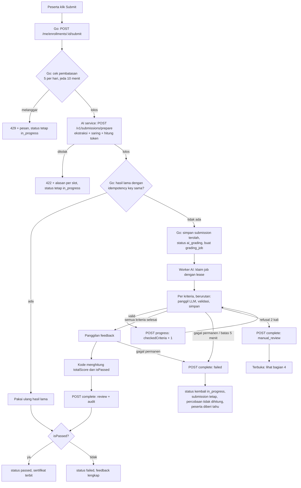

# Desain sistem AI Reviewer: service, antrean, dan kontrak dengan backend Go

Status: **usulan tim ML/LLM, belum dibahas tim backend**. Mengikuti AI-CONTEXT (bagian 2-8) dan CONTEXT.md; perbedaan yang diusulkan ada di `PROPOSED-CHANGES.md`. Penanda status:

- **[Ada]** sudah diimplementasikan dan dites di `ml/`.
- **[Desain]** antarmuka dan aturan sudah ditentukan, kode belum ada.
- **[Terbuka]** perlu keputusan tim.

## 1. Alur lengkap



Retry di dalam satu panggilan (tidak terlihat di diagram) mengikuti AI-CONTEXT 7: output tidak valid maks. 2 kali ulang, error 5xx/429/timeout maks. 3 kali ulang dengan jeda 2, 4, 8 detik, refusal 1 kali ulang. **[Ada]** di `reviewer/src/grade.py`.

## 2. Pembagian tanggung jawab

| Komponen | Pemilik | Tugas |
| --- | --- | --- |
| API publik, auth, enrollment, status | **Go** | Endpoint di AI-CONTEXT 3.2. Satu-satunya yang menulis ke tabel enrollment. |
| Pembatasan pemakaian | **Go** | 5 submission AI per peserta per hari, jeda 10 menit per case. Dicek sebelum memanggil AI service. |
| Penyimpanan berkas | **Go** | Unggahan ke object storage. AI service hanya menerima URL bertanda tangan berumur pendek. |
| Pipeline input (ekstraksi, saring zip, hitung token) | **AI service (Python)** | Sinkron saat submit, supaya submission bermasalah ditolak langsung (AI-CONTEXT 5.2). |
| Antrean job | **Go** (tabel `grading_jobs` di Postgres) | Satu job per submission, `idempotency_key` unik, lease. |
| Worker penilaian | **AI service (Python)** | Klaim job, jalankan `grade()`, laporkan progres dan hasil ke Go. Tidak menulis ke database Go secara langsung. |
| Prompt, rubrik versi, validasi output, skor | **AI service** | `prompts/v1/`, `src/validate.py`, `src/score.py`. Skor juga bisa dihitung ulang Go dengan rumus yang sama (`client/src/lib/score.ts`). |
| Sertifikat, notifikasi | **Go** | Setelah menerima hasil `completed`. |

Alasan worker Python tidak mengakses database langsung: satu pemilik skema data, dan AI service bisa diganti (provider atau bahasa) tanpa migrasi.

## 3. Kontrak antar layanan **[Desain]**

Semua endpoint internal memakai jaringan privat dan token layanan (bukan token peserta). JSON memakai camelCase agar sejalan dengan tipe frontend.

### 3.1 AI service: siapkan submission (sinkron)

`POST /v1/submissions/prepare`, timeout 30 detik.

```json
{
  "caseSlug": "optimasi-api-endpoint-produk",
  "rubricId": "optimasi-api-endpoint-produk",
  "rubricVersion": 1,
  "slots": [
    { "id": "kode", "kind": "code_zip", "fileUrl": "https://storage/...signed", "fileName": "proyek.zip", "sizeBytes": 1834221 },
    { "id": "penjelasan", "kind": "text", "text": "..." }
  ],
  "note": "catatan opsional peserta"
}
```

Respons sukses (200):

```json
{
  "preparedSubmissionId": "prep_7f3a...",
  "submissionHash": "sha256...",
  "tokenCount": 38211,
  "flags": ["secret_detected"],
  "notices": [{ "slotId": "kode", "message": "Berkas .env tidak ikut dinilai." }]
}
```

Respons ditolak (422), pesan siap ditampilkan per slot:

```json
{
  "rejections": [
    { "slotId": "kode", "code": "zip_no_readme", "message": "README wajib ada di root zip atau satu tingkat di bawahnya." },
    { "slotId": null, "code": "too_many_tokens", "message": "Submission terlalu besar. Kurangi berkas yang tidak perlu." }
  ]
}
```

Identitas peserta (nama, email, kampus, ID akun) **tidak dikirim** ke endpoint ini. Builder prompt menolak field selain `slots` dan `note` (**[Ada]**, `SubmissionShapeError`).

### 3.2 Go: antarmuka worker

| Endpoint (Go, internal) | Isi | Catatan |
| --- | --- | --- |
| `POST /internal/ai-grading/jobs/claim` | `{ "workerId": "..." }` -> job berikut atau 204 | Lease 6 menit (> batas job 5 menit). `SELECT ... FOR UPDATE SKIP LOCKED`. |
| `POST /internal/ai-grading/jobs/{jobId}/progress` | `{ "idempotencyKey", "checkedCriteria": 2 }` | Dipanggil setelah hasil kriteria valid **dan** tersimpan. Go menolak nilai yang turun. |
| `POST /internal/ai-grading/jobs/{jobId}/complete` | `{ "idempotencyKey", "status": "completed" \| "failed" \| "manual_review", "review": IReviewResult \| null, "audit": {...}, "failureReason": "..." }` | Idempoten: panggilan kedua dengan kunci sama tidak mengubah apa pun. |

Isi job yang diklaim: `jobId`, `idempotencyKey`, `preparedSubmissionId` (atau isi submission terolah), `case`, `rubric` (versi yang berlaku saat submit), `pipelineFlags`, `deadline`.

**Idempotency key** = SHA-256 dari {hash submission terolah, rubric_id, rubric_version, prompt_version, model, effort}. **[Ada]** `grade.idempotency_key()`. Dipakai untuk: (a) job yang diklaim ulang setelah worker mati tidak menilai ulang kriteria yang sudah tersimpan, (b) submission identik memakai ulang hasil lama (AI-CONTEXT 6.1 langkah 3), (c) `complete` yang terkirim dua kali tidak menerbitkan dua sertifikat.

### 3.3 Batas waktu

- Satu job: **5 menit** (AI-CONTEXT 8). Worker berhenti sebelum memanggil LLM bila batas terlewati dan mengirim `failed`. **[Ada]**
- Satu panggilan LLM: 90 detik (`config/models.json`). Retry bawaan SDK dimatikan agar jumlah percobaan sesuai tabel 7. **[Ada]**
- Lease job 6 menit. Bila worker mati, job bisa diklaim worker lain; kriteria yang sudah tersimpan tidak dinilai ulang.

## 4. Status dan transisi

| Dari | Ke | Pemicu | Catatan |
| --- | --- | --- | --- |
| `in_progress` | `ai_grading` | Submit lolos pembatasan dan `prepare` | Buat `grading_job`. |
| `ai_grading` | `passed` / `failed` | `complete` dengan `status: completed` | Sertifikat terbit bila lulus. |
| `ai_grading` | `in_progress` | `complete` dengan `status: failed`, atau lease habis 2 kali | Submission tetap tersimpan dan terisi di form, peserta diberi tahu, **tidak dihitung** sebagai percobaan maupun kuota harian. |
| `ai_grading` | ? | `complete` dengan `status: manual_review` (refusal 2 kali) | **[Terbuka]** Usulan: kembali ke `in_progress` seperti gagal sistem, ditambah antrean tinjauan internal. Alternatif: tetap `ai_grading` sampai tim menilai, tetapi UI belum punya pesan untuk menunggu berjam-jam. |
| `failed` | `in_progress` | `POST /me/enrollments/:id/retry` | Isian sebelumnya tetap terisi. |

**Status tidak boleh macet di `ai_grading`.** Go menjalankan pembersih berkala: job yang lease-nya habis 2 kali dianggap gagal sistem.

### 4.1 `checkedCriteria` jujur

- Hanya naik setelah output kriteria **lolos validasi dan tersimpan**. **[Ada]**, diuji di `test_happy_path_builds_review_result` dan `test_invalid_output_exhausted_fails_with_honest_progress`.
- Urutan mengikuti urutan rubrik.
- Nilai maksimal = jumlah kriteria. Langkah terakhir "Menyusun skor dan feedback" di UI berlangsung saat `checkedCriteria` = jumlah kriteria dan status masih `ai_grading`. Ini sama dengan perilaku mock `client/src/mocks/grading.ts`.
- Submission identik yang memakai hasil lama langsung lompat ke jumlah kriteria.

### 4.2 `estimatedDoneAt` jujur

Hanya untuk tampilan. Dihitung Go:

```
estimatedDoneAt = sekarang + (jumlah kriteria - checkedCriteria + 1) x p50 latensi satu panggilan
```

p50 diambil dari `ai_call_logs` 7 hari terakhir untuk model yang aktif (default 10 detik bila belum ada data), lalu dihitung ulang setiap progres masuk. Bila antrean panjang, tambahkan perkiraan waktu tunggu antrean. Jangan menampilkan perkiraan yang sudah lewat: bila `estimatedDoneAt` < sekarang, geser ke sekarang + p50.

## 5. Pencatatan per penilaian

Isi audit yang dikirim worker **[Ada]** (`grade._audit`): model, effort, prompt_version, rubric_id, rubric_version, submission_hash, token per jenis, biaya, durasi, flags, confidence per kriteria, evidence, log setiap percobaan panggilan, dan `needs_manual_sample`. Usulan skema Postgres **[Desain]**:

```sql
CREATE TABLE ai_assessments (
  id                          uuid PRIMARY KEY,
  enrollment_id               uuid NOT NULL,
  submission_id               uuid NOT NULL,
  idempotency_key             char(64) NOT NULL UNIQUE,
  status                      text NOT NULL CHECK (status IN ('completed','failed','manual_review')),
  model                       text NOT NULL,
  effort                      text NOT NULL,
  prompt_version              text NOT NULL,
  rubric_id                   text NOT NULL,
  rubric_version              int  NOT NULL,
  submission_hash             char(64) NOT NULL,
  total_score                 int,
  is_passed                   boolean,
  flags                       text[] NOT NULL DEFAULT '{}',
  input_tokens                int NOT NULL DEFAULT 0,
  cache_creation_input_tokens int NOT NULL DEFAULT 0,
  cache_read_input_tokens     int NOT NULL DEFAULT 0,
  output_tokens               int NOT NULL DEFAULT 0,
  cost_usd                    numeric(12,6) NOT NULL DEFAULT 0,
  duration_ms                 int NOT NULL,
  call_count                  int NOT NULL,
  needs_manual_sample         boolean NOT NULL DEFAULT false,
  failure_reason              text,
  created_at                  timestamptz NOT NULL DEFAULT now()
);

CREATE TABLE ai_criterion_results (
  assessment_id   uuid REFERENCES ai_assessments(id),
  position        int  NOT NULL,          -- urutan di rubrik
  criterion_id    text NOT NULL,
  criterion_name  text NOT NULL,
  weight          int  NOT NULL,
  level           int  NOT NULL CHECK (level BETWEEN 1 AND 5),
  reason          text NOT NULL,          -- tampil ke peserta
  evidence        jsonb NOT NULL,         -- internal saja
  confidence      text NOT NULL CHECK (confidence IN ('low','medium','high')),
  flags           text[] NOT NULL DEFAULT '{}',
  PRIMARY KEY (assessment_id, criterion_id)
);

CREATE TABLE ai_call_logs (
  id                          bigserial PRIMARY KEY,
  assessment_id               uuid REFERENCES ai_assessments(id),
  call                        text NOT NULL,   -- 'criterion:analisis' | 'feedback'
  attempt                     int  NOT NULL,
  outcome                     text NOT NULL,   -- ok | invalid_output | transient_error | permanent_error | refusal
  model                       text NOT NULL,
  stop_reason                 text,
  refusal_category            text,
  input_tokens                int, cache_creation_input_tokens int, cache_read_input_tokens int, output_tokens int,
  cost_usd                    numeric(12,6),
  latency_ms                  int,
  problems                    jsonb,           -- alasan output tidak valid
  created_at                  timestamptz NOT NULL DEFAULT now()
);
CREATE INDEX ON ai_call_logs (model, created_at);
```

Teks prompt lengkap **tidak** disimpan secara default (bisa direkonstruksi dari versi prompt, rubrik, dan submission). Data audit hanya untuk tim internal (AI-CONTEXT 11).

## 6. Pembatasan pemakaian dan kontrol biaya

| Kontrol | Tempat | Status | Aturan |
| --- | --- | --- | --- |
| 5 submission AI per peserta per hari | Go, saat submit | [Desain] | Hari kalender WIB **[Terbuka]**. Percobaan yang gagal karena sistem tidak dihitung. |
| Jeda 10 menit antar percobaan di case yang sama | Go, saat submit | [Desain] | Dihitung dari submit terakhir yang dinilai. |
| Batas 60.000 token per submission | AI service, `prepare` | [Desain] | Tolak, jangan potong diam-diam (5.5). Hitung dengan endpoint token counting resmi, bukan perkiraan karakter. |
| Hasil ulang submission identik | Go + worker | [Ada] di worker | Idempotency key (bagian 3.2). |
| Prompt caching | Worker | [Ada] | 2 breakpoint: akhir blok case, akhir blok submission. Panggilan kriteria berurutan. |
| Anggaran harian | Go | [Desain] | Jumlahkan `cost_usd` per hari. Alarm di 80% dan 100%. Di 100%, jeda pengambilan job: submission tetap diterima dan antre (8: "diproses setelah pulih"). |
| Model dan effort dikunci | `config/models.json` | [Ada] | Ganti hanya setelah lolos golden set ulang (10.3). |

## 7. Pipeline input (ringkas) **[Desain]**, kecuali yang ditandai

Antarmuka Python yang diusulkan:

```python
def prepare_submission(rubric: dict, slots: list[SlotUpload], note: str | None) -> PreparedSubmission | list[Rejection]:
    """Ekstraksi per jenis slot, penyaringan, penanda path/halaman, hitung token, flags."""
```

| Jenis slot | Ekstraksi | Aturan utama |
| --- | --- | --- |
| `text` | Normalisasi spasi, hitung kata | Batas kata dari rubrik (`min_words`, `max_words`). |
| `document` PDF/DOCX | Teks per halaman/bagian dengan penanda `=== HALAMAN 3 ===` | Tolak bila tidak ada teks (hasil scan). Teks tersembunyi tetap dikirim sebagai data (5.4). |
| `document` XLSX | Per sheet sebagai tabel teks, formula **dan** nilainya untuk sel berformula | Maks. 500 baris pertama per sheet + jumlah baris (5.4). |
| `design_pdf` | Tidak diekstrak: dikirim sebagai blok dokumen PDF agar dibaca visual | Maks. 20 halaman, 15 MB; pemeriksaan "berisi teks" tidak berlaku (5.6). Builder saat ini hanya mendukung blok teks; perlu ditambah blok dokumen. |
| `code_zip` | Ekstraksi di lingkungan terisolasi, tidak ada yang dijalankan | Lihat di bawah. |

Aturan zip (AI-CONTEXT 5.3): maks. 20 MB terkompresi, 100 MB dan 2.000 berkas setelah ekstraksi (hentikan begitu terlewati: *zip bomb*); tolak path `../`, path absolut, dan symlink (*zip slip*); abaikan folder dependensi/build, biner, media, lockfile, minified, dan teks > 200 KB; berkas rahasia (`.env`, `*.pem`, `*.key`, pola kunci API) tidak dikirim dan memberi flag `secret_detected`; README wajib; tolak bila setelah disaring hampir kosong. Urutan: README, berkas konfigurasi utama, lalu kode per folder, masing-masing dengan penanda `=== FILE: path ===`.

Yang **[Ada]** di `ml/`: netralisasi tag dan karakter tak terlihat, deteksi pola injection, penolakan field identitas, catatan feedback otomatis untuk `secret_detected` (`prompts/v1/builder.py`, `src/grade.py`). Ekstraktor PDF/DOCX/XLSX, aturan zip, dan penghitung token **belum** dibuat.

## 8. Risiko dan keputusan terbuka (tidak diputuskan di sini)

1. **Privasi dan UU PDP.** Dasar pemrosesan, pemberitahuan bahwa submission dinilai dengan bantuan AI pihak ketiga, dan teks kebijakan privasi (AI-CONTEXT 11).
2. **Retensi.** Berapa lama submission, `ai_call_logs`, dan evidence disimpan.
3. **Provider dan model final.** `active_model` di config hanya kandidat uji pertama (Haiku 5.5), belum keputusan.
4. **Status `manual_review`** (bagian 4).
5. **Kebijakan data provider.** Pastikan data API tidak dipakai melatih model dan pahami periode retensinya (AI-CONTEXT 11). Belum diverifikasi untuk akun tim.
6. **Fallback model saat refusal.** Desain ini sengaja tidak memakai fallback otomatis ke model lain, supaya satu penilaian selalu memakai satu model yang tercatat. Bila refusal sering terjadi di golden set, tim perlu memutuskan ulang.
7. **`copied_brief` otomatis level rendah** (AI-CONTEXT 7) butuh deteksi kemiripan dengan brief di pipeline. Belum dirancang rinci: aturan "kriteria terkait mana yang diturunkan" perlu ditulis per rubrik.
8. **Zona waktu kuota harian** (bagian 6).
